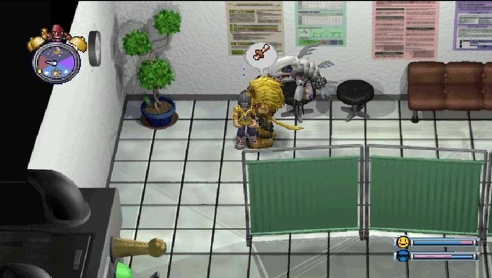
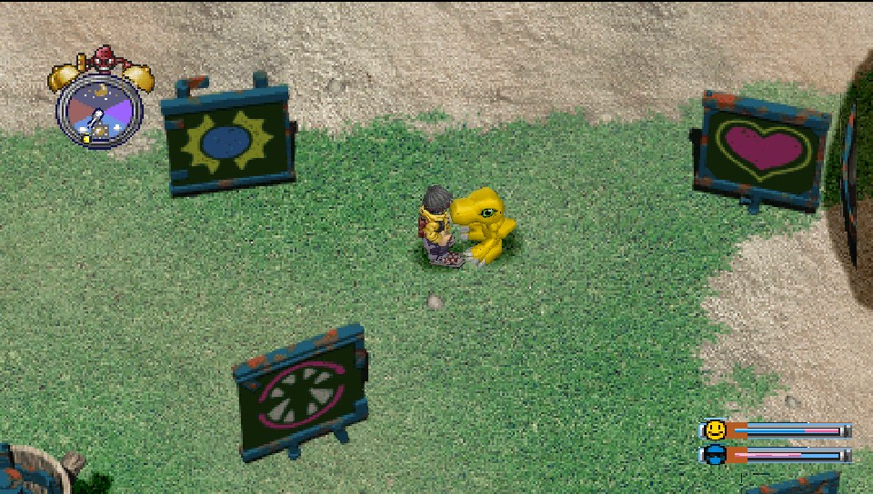
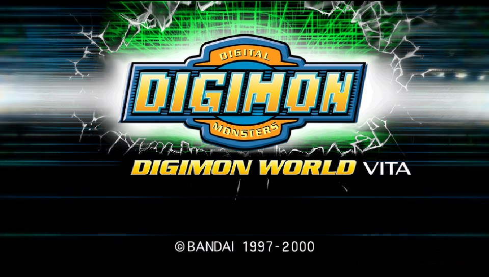
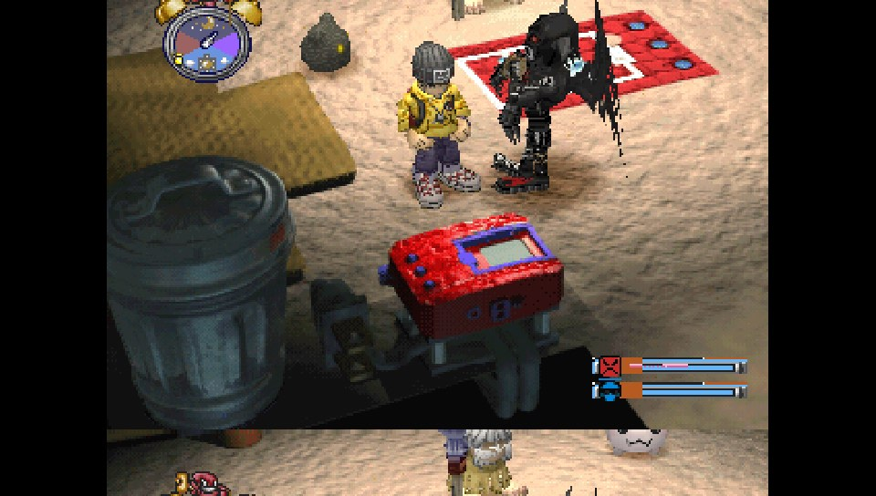

Digimon World — PS Vita Port (Test Build)

A native port of Digimon World (PlayStation, 1999 — US version) for PS Vita and PS TV.

This project started as a love letter to one of my all-time favorite games, one that I spent countless hours replaying back in the day. I'm developing it on my own, with help from Claude, driven by the desire to bring this classic to hardware I still love.

This is a test build, and there's still plenty of work to do. I'm just one person working on this in my spare time, so please keep in mind that new features, fixes and improvements take time. Getting the game playable in its current state has already taken me two weeks of testing, rebuilding, debugging and patching.

I'm sharing it now because I want other fans to be able to experience it, try it out and help me find issues I might have missed. It's a work in progress, but I hope you'll enjoy playing it as much as I've enjoyed bringing it to life.

This is not an emulator. The game's code runs natively on the device, with optional widescreen support, enhanced graphics, quality-of-life improvements and bug fixes.

> **Test build:** This port is playable, but it is still under development. Bugs, performance issues and incomplete features are possible.

<p align="center">
  
  
  
  
</p>

**Important:** This is a free, non-commercial fan project. It is not affiliated with or endorsed by Bandai Namco. No game data is included. You must provide your own copy of the game.

## Requirements

- A PS Vita or PS TV running HENkaku/Ensō.
- VitaShell to install the VPK and transfer files.
- Your own dump of **Digimon World (USA, SLUS-01032)**, in `.bin` + `.cue` format using raw 2352-byte sectors.

## Installation

### 1. Install the game

1. Download `dw1-vita.vpk` from the release files.
2. Transfer the VPK to your PS Vita.
3. Open VitaShell and install the VPK.

### 2. Add your game files

Create the following directory on your PS Vita:

`ux0:data/dw1/`

Copy your own game dump into this directory, using these exact filenames:

```text
ux0:data/dw1/
├── Digimon World (USA).bin
└── Digimon World (USA).cue
```

Make sure the `FILE` entry inside the `.cue` file matches the actual `.bin` filename.

### 3. Launch the game

Launch **Digimon World** from the LiveArea bubble.

The game reads its data from `ux0:data/dw1/`.

## Save files

Memory cards are stored at:

- `ux0:data/dw1/card1.mcd`
- `ux0:data/dw1/card2.mcd`

They use the raw 128 KB memory-card format, allowing saves to be transferred between this port and compatible emulators such as DuckStation and ePSXe.

**Tip:** Keep backups of your memory-card files, especially when testing new builds.

## Controls

The game uses the original PlayStation button layout mapped to the PS Vita controls.

Additional controls:

- **Left stick:** Move, as an alternative to the D-pad.
- **Touchscreen:** Walk and pet your Digimon.
- **L1:** Quick feeding.
- **Start:** Open the in-game pause menu to save or return to the title screen.

## Options and enhancements

Select **OPTIONS** on the title screen, below New Game / Continue. Your settings are saved to:

`ux0:data/dw1/options.ini`

| Section | Option | Default | Description |
|---|---|---|---|
| Video | Widescreen 16:9 | On | Widescreen presentation with HUD elements positioned near the screen edges. |
| Video | No polygon wobble | On | PGXP correction to reduce polygon wobble and texture warping. |
| Video | Model depth fix | Off | Adds depth-buffer support for 3D models. May reduce performance and reveal original model overlaps. |
| Video | 3D texture filter | Off | Smooths textures on 3D models. May reduce performance. |
| HD packs | HD backgrounds | On | Loads an HD background pack if available. |
| HD packs | HD object sprites | Off | Experimental HD map objects. |
| HD packs | HD movies | On | Loads upscaled FMVs if available. |
| Gameplay | Fair Bonus Try | On | Removes hidden slot-machine rigging and runs the gym slots at half speed. |
| Gameplay | Better battle gains | On | Adjusts stat gains according to how your Digimon fought. |
| Gameplay | Original bug fixes | On | Applies fixes for bugs in the original game from Vice hackrom. |
| Sound and extras | Audio | Improved | Uses smoother sample interpolation. The original audio mode is also available. |
| Sound and extras | Select: debug menu | Off | Enables the debug menu through Select. |

### Optional HD packs

The HD backgrounds, HD object sprites and HD intro movie are not inside the
VPK. They are separate downloads in the release, locked with data from the
original disc: **they only work with your own copy of the game.**

| File | What it adds | Option |
|---|---|---|
| `dw1-hd-backgrounds.dw1hd` (177 MB) | HD widescreen backgrounds for every area, with day, dusk and night | HD backgrounds (on) |
| `dw1-hd-objects.dw1hd` (24 MB) | HD doors, water, torches and other animated map objects | HD object sprites (off, experimental) |
| `dw1-hd-movies.dw1hd` (28 MB) | HD intro movie | HD movies (on) |

**How to install them (about one minute, done on your PC):**

1. Install **Python 3** from [python.org](https://www.python.org/downloads/).
   On Windows, tick **"Add python.exe to PATH"** in the installer.
2. Download **`dw1-hd-unlocker.zip`** and the `.dw1hd` packs you want from the
   [release](https://github.com/danicannt/dw-vita/releases/latest).
3. Unzip `dw1-hd-unlocker.zip` and put the `.dw1hd` files inside the
   `dw1-hd-unlocker` folder.
4. **Windows:** drag your `Digimon World (USA).cue` onto
   **`unlock_hd_pack.bat`**.
   **Linux / macOS:** `python3 unlock_hd_pack.py "path/to/Digimon World (USA).cue"`
5. An **`hd`** folder appears next to it. Copy that whole folder to
   **`ux0:data/dw1/`** on your Vita, so it looks like this:

```text
ux0:data/dw1/
├── Digimon World (USA).bin
├── Digimon World (USA).cue
└── hd/
    ├── MAYO01.hdm   (and the other .hdm / .hdo files)
    └── movies/
        └── OP1.mp4
```

6. Start the game. The HD packs are switched on and off in **OPTIONS > HD packs**.

If the unlocker says that files **do not match**, your disc image is not the
standard dump: it has to be Digimon World (USA), SLUS-01032, as a raw
`.bin` + `.cue` with 2352-byte sectors (the Redump dump).

**Prefer to make them yourself?** [tools/hd-pack](tools/hd-pack/README.md) has
the whole AI pipeline that made these packs (upscaling, widescreen extension,
movies). It builds them from your disc on your own PC; an NVIDIA GPU is
recommended, and it takes several hours.

## Known issues

- Area transitions may freeze for approximately one second while HD graphics load.
- **Model depth fix** and **3D texture filter** can reduce the frame rate.
- Some areas and gameplay sequences may not have been fully tested.
- Visual glitches, crashes and other bugs may still occur.
- When digievolution happens, backgrounds dissapear, save game and exit to menu to reload.
- Championships: the crash in the opening camera and the black arena are fixed in v0.1.1-test. Please report anything that still goes wrong in a cup.

Back up your saves regularly and report any issues you encounter.

## Reporting bugs

When reporting an issue, please include:

1. What you were doing when the issue occurred.
2. The area or gameplay sequence where it happened.
3. A screenshot or a description of the issue, if possible.
4. The log file generated by the game:

   `ux0:data/dw1/log.txt`

The log is overwritten each time the game launches, so copy it immediately after reproducing the issue.

Please also mention whether you were using HD packs or any non-default graphics options.

## Credits

- [jype0/dw_decomp](https://github.com/jype0/dw_decomp) (MIT) and [SydMontague](https://github.com/SydMontague/DW1-Code) for the decompilation and reverse-engineering work.
- [PSY-Z](https://github.com/Xeeynamo/psyz) (MIT), by Xeeynamo and contributors.
- [vitaGL](https://github.com/Rinnegatamante/vitaGL).
- [DW2-PC](https://github.com/Wyrelade/DW2-PC) (CC0), for ideas and approaches to overlays and memory layout.

## Disclaimer

*Digimon World* and all associated game assets and trademarks belong to their respective rights holders.

This is an unofficial, free, non-commercial fan project. It is not affiliated with or endorsed by Bandai Namco. No copyrighted game data is distributed with this project.

